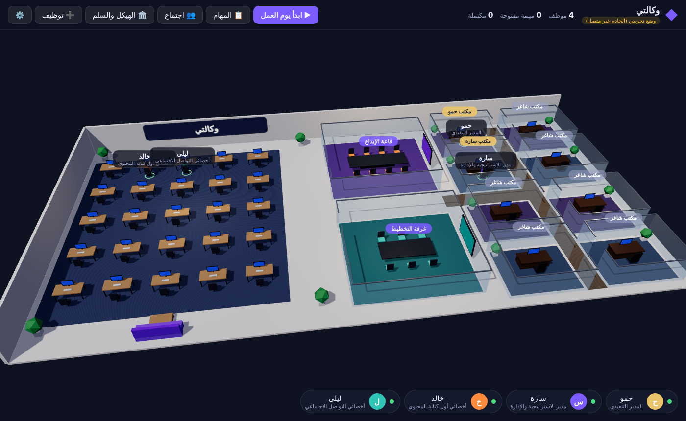
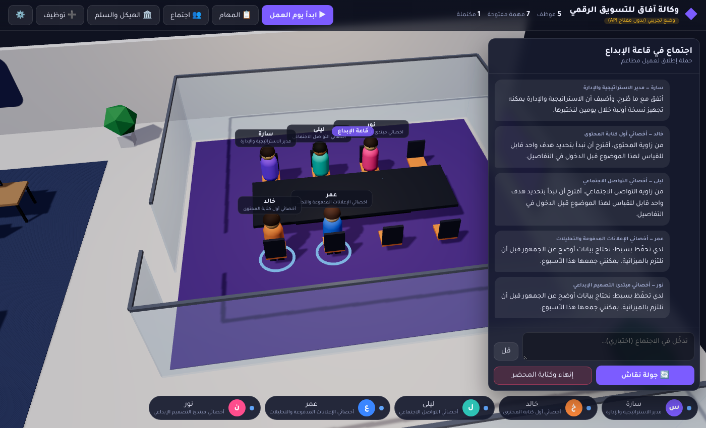

# 🏢 وكالة التسويق بالذكاء الاصطناعي (3D)

مكتب ثلاثي الأبعاد لوكالة تسويق، كل موظف فيه وكيل ذكاء اصطناعي له اسم ومسمى وظيفي وشخصية وقسم.




## المميزات

- **مكتب ثلاثي الأبعاد**: 16 مكتباً، غرفتا اجتماعات زجاجيتان («قاعة الإبداع» 8 مقاعد، «غرفة التخطيط» 6 مقاعد)، وموظفون متحركون. حرّك الكاميرا بالسحب والتكبير بالعجلة.
- **4 موظفين مبدئياً** ويمكن زيادتهم حتى 16:
  | الموظف | المسمى | القسم |
  |---|---|---|
  | سارة | مدير الاستراتيجية والإدارة | الاستراتيجية |
  | خالد | أخصائي أول كتابة المحتوى | المحتوى |
  | ليلى | أخصائي التواصل الاجتماعي | التواصل الاجتماعي |
  | عمر | أخصائي الإعلانات المدفوعة والتحليلات | الإعلانات |
- **مهام افتراضية**: 8 مهام جاهزة (خطة ربعية، تحليل منافسين، تقويم إنستغرام، حملة ميتا…). زر **«ابدأ يوم العمل»** يجعل كل موظف ينفّذ مهامه بالترتيب حسب الأولوية، ويمكن عرض كل نتيجة ونسخها.
- **المدير يوزّع المهام عند الطلب**: اطلب من سارة في المحادثة، مثلاً «كلّفي خالد وليلى بمهام عن إطلاق منتج جديد»، فتكلّف من ذكرتهم بمهام مرتبطة بمسمى كل واحد وتخصصه، وتؤكد لك في المحادثة ما كلّفت به كل موظف. يمكن أيضاً استخدام زر «كلّف فريقك بمهام» في ملفها، أو زر «المدير يوزّع المهام» في لوحة المهام. لا تكلّف أحداً تلقائياً، وإذا تعذّر الذكاء الاصطناعي تُستخدم مكتبة مهام جاهزة لكل قسم.
- **محادثة مباشرة** مع أي موظف بالضغط عليه في المكتب أو في الشريط السفلي.
- **اجتماعات**: اختر الغرفة والموضوع والحضور، فيمشي الموظفون إلى الغرفة ويتناقشون بالدور. يمكنك التدخل، ثم يكتب أعلى الحاضرين رتبة المحضر.
- **سلم وظيفي من 9 مستويات**: متدرب ← أخصائي مبتدئ ← أخصائي ← أخصائي أول ← قائد فريق ← مدير ← مدير إدارة ← المدير العام ← المدير التنفيذي. كل مهمة منجزة تمنح نقاط خبرة، وعند بلوغ الحد يصبح الموظف مستحقاً للترقية، والقرار لك.
- **12 قسماً** للتوظيف: الإدارة التنفيذية، الاستراتيجية، التسويق، المبيعات، الموارد البشرية، المحتوى، التواصل الاجتماعي، الإعلانات، التصميم، SEO، العلاقات العامة، البريد.
- **مناصب جاهزة** في نموذج التوظيف: المدير التنفيذي، المدير العام، مدير التسويق، مدير المبيعات، مدير الموارد البشرية. كل منصب يشغله شخص واحد، ويُربط تلقائياً بمديره المناسب. وعند توظيف مدير تنفيذي أو عام يمكن نقل المدراء الحاليين تحت إدارته.
- **هيكل تنظيمي** (من يدير من) قابل للتعديل، مع مسميات تلقائية أو مخصصة.
- كل شيء يُحفظ تلقائياً في المتصفح.

## نسخة أونلاين على claude.ai

الصفحة نفسها منشورة كـArtifact خاص على claude.ai. هناك يرد الموظفون عبر حسابك في Claude مباشرة، دون مفتاح API ودون خادم. وتُحفظ الوكالة على خوادم claude.ai في مساحة خاصة بكل مستخدم، فتظهر لك نفسها من أي جهاز. لتحديثها بعد أي تعديل:

```bash
npm run build:artifact   # ينتج dist/agency.html
```
ثم انشر `dist/agency.html` من جديد على نفس الرابط.

## التشغيل

يحتاج Node.js 22 أو أحدث.

```bash
cd ai-agency
npm install
cp .env.example .env
```

ضع مفتاحك في ملف `.env` بعد `ANTHROPIC_API_KEY=` ثم:

```bash
npm start
```

ثم افتح http://127.0.0.1:3000

بدون مفتاح API يعمل التطبيق في **وضع تجريبي** بردود جاهزة، حتى تجرّب الواجهة. احصل على مفتاح من https://console.anthropic.com

## البنية

```
ai-agency/
├── server.js          خادم Node: يقدّم الصفحة ويمرّر المحادثات إلى Claude (المفتاح يبقى في الخادم)
├── public/js/prompt.js التحقق من الطلبات وبناء شخصية كل موظف
├── public/
│   ├── index.html     الواجهة (عربية RTL)
│   ├── styles.css
│   └── js/
│       ├── scene.js   المكتب ثلاثي الأبعاد (Three.js)
│       ├── data.js    السلم الوظيفي، الأقسام، الفريق والمهام الافتراضية
│       ├── api.js     الاتصال بالخادم + الوضع التجريبي
│       └── app.js     منطق التطبيق: محادثة، مهام، اجتماعات، توظيف، ترقيات
│       └── cloud.js   الحفظ السحابي على claude.ai (قدرة db)
├── scripts/build-artifact.mjs   يبني نسخة الصفحة الواحدة للنشر على claude.ai
└── test/              اختبارات (npm test)
```

## الأمان

- مفتاح API لا يصل إلى المتصفح أبداً، ويُقرأ من متغيرات البيئة فقط.
- التحقق من كل المدخلات وحدود لطولها، وتحديد عدد الطلبات لكل IP (30 في الدقيقة افتراضياً).
- سياسة CSP صارمة، ولا يُدرج أي نص من الذكاء الاصطناعي كـHTML.
- الخادم يستمع على 127.0.0.1 افتراضياً. لا تفتحه للإنترنت بدون تسجيل دخول، وإلا يمكن لأي شخص استهلاك رصيدك.

## التكلفة

يستخدم `claude-opus-5-5` افتراضياً (يمكن تغييره بـ`AGENCY_MODEL`). المحادثات والاجتماعات تعمل بجهد منخفض لتكون سريعة واقتصادية، وتنفيذ المهام بجهد متوسط.
